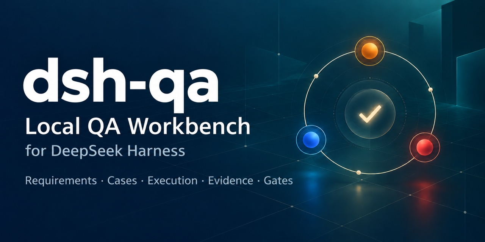
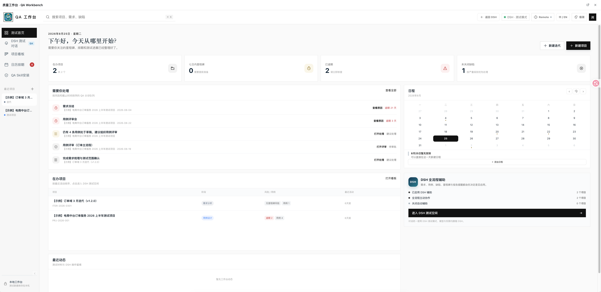

<strong>🇨🇳 中文</strong> | <strong><a href="./README_EN.md">🇬🇧 English</a></strong>

# dsh-qa · 质量工作台

  

**dsh-qa 是运行在 DeepSeek Harness（DSH）中的本地 QA 工作台，面向在个人工作环境中管理质量流程的 QA 和测试负责人。**它把测试项目、需求、用例、执行、证据与交付门禁放在一个工作区，并复用 DSH 原生会话、模型、技能和命令。

## 目录

- [定位与职责边界](#定位与职责边界)
- [工作流与主要能力](#工作流与主要能力)
- [安装与首次使用](#安装与首次使用)
- [数据、集成与兼容性](#数据集成与兼容性)
- [开发与相关文档](#开发与相关文档)
- [许可证与常见问题](#许可证与常见问题)

## 定位与职责边界

| 工作台 | 主要职责 | 与 dsh-qa 的关系 |
| --- | --- | --- |
| DeepSeek Harness | 提供 AI 会话、模型、技能、命令和插件运行环境 | dsh-qa 作为插件运行在 DSH 中，沿用这些原生能力 |
| dsh-qa | 在本机管理 QA 项目、测试材料、执行证据和质量门禁 | 为单个 QA 的日常质量工作提供结构化流程 |
| 团队项目或测试管理系统 | 承载团队共享流程和跨系统记录 | 需要团队同步时继续使用现有系统；dsh-qa 当前不提供 WPS、禅道连接器或远端数据同步 |

dsh-qa 适合希望在 DSH 项目会话旁维护测试材料、执行记录和交付依据的 QA。项目数据保存在本机；它不承担团队协作平台、远端仓库监控或跨系统数据同步的职责。

## 工作流与主要能力

~~~mermaid
flowchart LR
  A[需求与验收标准] --> B[需求与测试用例]
  B --> C[质量任务与执行准备]
  C --> D[受控执行]
  D --> E[证据、失败分析与回归]
  E --> F{质量门禁}
  E -->|需要复测| D
  F -->|PASS| G[交付报告]
  F -->|WARN / BLOCK| H[负责人评审]
~~~

| 环节 | 工作内容 |
| --- | --- |
| 项目与计划 | 管理测试项目或迭代，并通过首页、看板和日历跟踪进度 |
| 测试材料 | 维护需求、测试用例、缺陷、里程碑、知识和报告 |
| DSH 协作 | 每个项目使用独立 DSH 会话并自动进入 qa Test Mode；插件 bundle 也提供 quality-control preset |
| 执行与证据 | 管理质量任务与执行配置，启动受支持的 Host 执行，归档证据并处理失败与回归 |
| 交付评审 | 按运行来源、证据、测试结果和风险计算 PASS / WARN / BLOCK，由负责人审核待处理项 |

界面提供执行配置、Host 执行和门禁评估；测试计划创建与评审、本地运行预览目前仍有部分步骤需要通过服务端 API 完成。

质量门禁综合检查运行来源、已验证证据、关键测试结果与风险状态；未完成的运行不会作为最终结果。外部 provider 的真实执行能力需单独验收。

查看工作台界面截图

## 安装与首次使用

### 在 DSH Web 中安装（推荐）

~~~bash
npx --yes @deepseek-ai/dsh plugin --profile web add dsh-qa
npx --yes @deepseek-ai/dsh web
~~~

重启 DSH Web 后，从侧边栏打开「质量工作台」。安装主 bundle 会同时提供 qa 与 quality-control preset。使用 Harness 源码仓库或官方 macOS 客户端时，请按[中文使用指南](./docs/quality-workbench/user-guide-zh-CN.md)中的对应步骤安装。

### 独立运行

需要 Node.js 18 或更新版本。独立模式可查看和管理本地 QA 项目；DSH 对话、模型、技能与命令需从 DSH 插件入口使用。

~~~bash
npm install -g dsh-qa
qabench
~~~

首次使用时，新建测试项目或迭代，补充需求、验收标准和可访问的代码上下文，再维护用例与风险、创建质量任务。后续执行和门禁操作见[中文使用指南](./docs/quality-workbench/user-guide-zh-CN.md)。

## 数据、集成与兼容性

- 插件模式的项目与材料保存在本机的 ~/.dsh/dsh-qa/；DSH 对话由 DSH 自己保存。
- 看板实时更新用于同一台机器上的多个窗口，不会同步给其他团队成员。
- 质量任务可采集受支持的本地 Git diff 快照；dsh-qa 不监听远端仓库变化，也不会自动拉取代码。
- 当前没有 WPS 或禅道连接器。模型、密钥和权限由 DSH 管理。
- 已在 DeepSeek Harness v0.2.0-rc.2 官方 macOS 客户端验证插件加载、qa 测试模式和已有会话展示；同版本 qa Host Smoke 为 6 passed。该结果不代表 quality-control bundle 已完成独立宿主验证。

## 开发与相关文档

~~~bash
npm ci
npm start
npm test
~~~

- [完整安装与使用指南](./docs/quality-workbench/user-guide-zh-CN.md)
- [质量工作台设计与路线文档](./docs/quality-workbench/README.md)
- [质量交付流程图](./docs/diagram/quality-workflow/dsh-qa-quality-workflow.svg)
- [配套 QA Skills](https://github.com/naodeng/awesome-qa-skills)
- [版本记录](./CHANGELOG.md)

欢迎提交 Issue 与 PR。发布前请阅读 [PolyForm Noncommercial License 1.0.0](./LICENSE)，本项目仅限非商业用途。

## 许可证与常见问题

**许可证**：[PolyForm Noncommercial 1.0.0](./LICENSE)，仅限非商业用途。

- **侧边栏没有入口**：重启 DSH Web，让插件重新加载。
- **模型不可用或鉴权失败**：在 DSH 设置中检查服务商、模型和凭据。
- **看不到技能或命令**：从 DSH 侧边栏打开插件；独立运行模式不提供 DSH 会话能力。
- **质量门禁为 BLOCK**：先查看交付报告中的失败检查、证据缺口或风险，再由负责人处理。

[English README](./README_EN.md) · [中文使用指南](./docs/quality-workbench/user-guide-zh-CN.md) · [English user guide](./docs/quality-workbench/user-guide-en.md)
